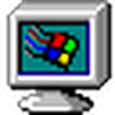
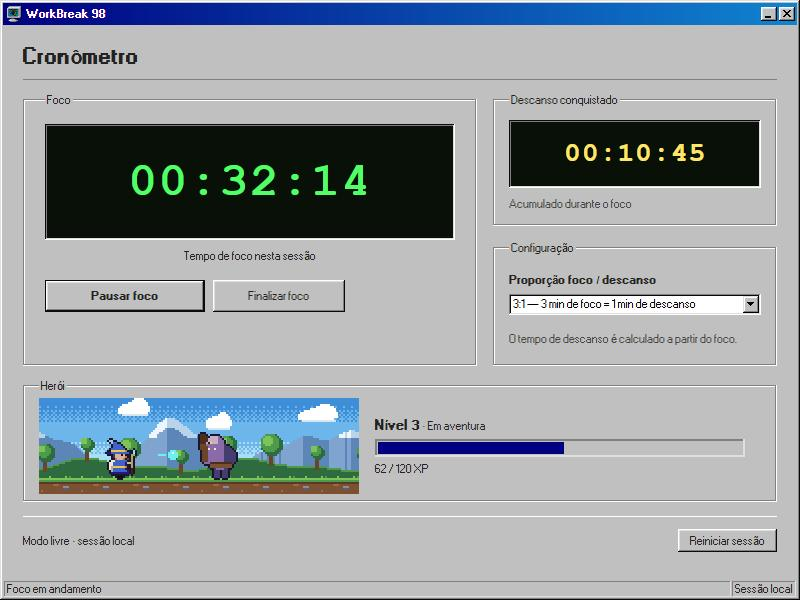
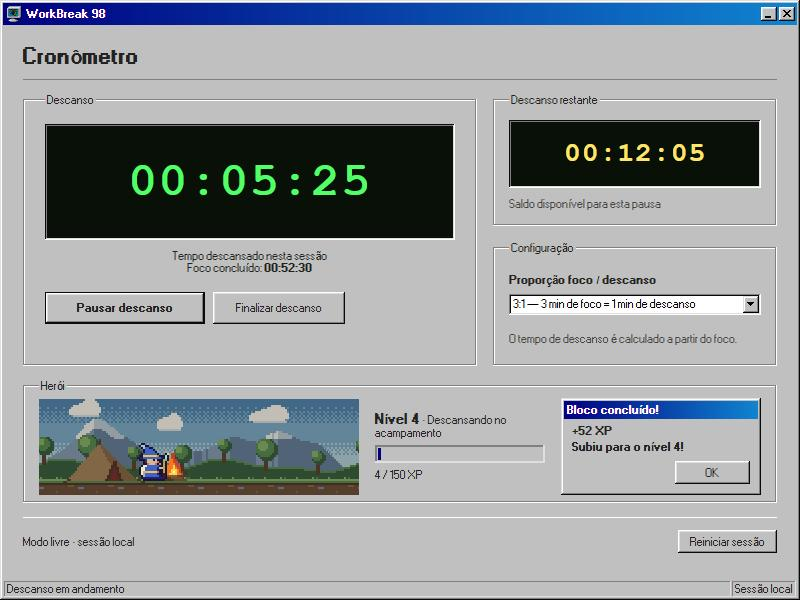
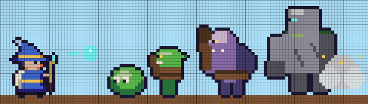

<p align="center">
  
</p>

<h3 align="center">WorkBreak 98</h3>

<div align="center">

[](#)
[](https://github.com/ericksantos12/workbreak-98/actions/workflows/check.yml)
[](https://github.com/ericksantos12/workbreak-98/releases)
[](https://github.com/ericksantos12/workbreak-98/issues)
[](https://github.com/ericksantos12/workbreak-98/pulls)

</div>

---

<p align="center">Um cronômetro Flowmodoro para Windows com a aparência clássica do Windows 98.<br>
Trabalhe no seu ritmo, acumule descanso proporcional ao foco e acompanhe um pequeno mago que sobe de nível com foco saudável.</p>

<p align="center">
  
  
</p>

## 📝 Sumário

- [Sobre](#about)
- [Primeiros passos](#getting_started)
- [Executando os testes](#tests)
- [Uso](#usage)
- [Distribuição](#deployment)
- [Feito com](#built_using)
- [Autores](#authors)
- [Agradecimentos](#acknowledgement)

## 🧐 Sobre <a name="about"></a>

O WorkBreak 98 aplica a técnica Flowmodoro: em vez de blocos fixos de tempo, você foca pelo tempo que fizer sentido e ganha descanso proporcional ao foco. Tudo roda localmente, sem conta ou sincronização, numa janela no estilo Windows 98.

Para tornar o hábito mais divertido, um herói em pixel art acompanha a sessão. Durante o foco, ele atravessa uma trilha em side scrolling e derrota inimigos que ficam maiores conforme o bloco se estende. No descanso, ele monta acampamento junto à fogueira. Quando o timer está pausado, ele cochila. A experiência premia **foco saudável**: blocos longos demais não rendem mais XP, e cumprir o descanso dá bônus.

<p align="center">
  
</p>

## 🏁 Primeiros passos <a name="getting_started"></a>

Estas instruções preparam uma cópia do projeto para desenvolvimento e testes. Para gerar o instalador, veja [Distribuição](#deployment).

### Pré-requisitos

A implementação nativa atual usa APIs do Windows. Instale:

- Node.js **22.12+ na linha 22**, **24.x** ou **26+**, acompanhado do npm.
- Rust e Cargo pelo Rustup, com a toolchain MSVC.
- Visual Studio Build Tools com a carga **Desenvolvimento para desktop com C++** e o Windows SDK.
- Microsoft Edge WebView2 Runtime.

### Instalação

Na raiz do repositório, instale as dependências:

```powershell
npm ci
```

Inicie o aplicativo desktop com recarga durante o desenvolvimento:

```powershell
npm run app
```

O script prepara o `PATH` do Cargo no Windows e inicia o Tauri junto com o Vite. A porta **1420** precisa estar livre; não é necessário executar `npm run dev` antes.

| Comando | O que faz |
| --- | --- |
| `npm run app` | Executa o aplicativo desktop com recarga durante o desenvolvimento |
| `npm run dev` | Executa apenas o frontend; não disponibiliza os comandos nativos do timer |
| `npm run build` | Verifica TypeScript e gera o frontend em `dist/`; não compila Rust |
| `npm run build:exe` | Compila o aplicativo e gera o instalador Windows |
| `cargo check --manifest-path src-tauri/Cargo.toml` | Verifica o código Rust sem gerar o instalador |

## 🔧 Executando os testes <a name="tests"></a>

```powershell
npx vitest run
cargo test --manifest-path src-tauri/Cargo.toml
node --test .github/scripts/release.test.mjs
cargo fmt --manifest-path src-tauri/Cargo.toml -- --check
```

- **Vitest** cobre a apresentação e a sincronização da interface (`src/**/*.test.ts(x)`), incluindo o painel do herói.
- **Testes Rust** cobrem as regras de tempo, a recuperação da sessão e a progressão do herói, com um relógio controlável que dispensa esperar minutos reais.
- **`node --test`** cobre o script que lê o `CHANGELOG.md` e aplica a versão no build.
- **`cargo fmt --check`** confere a formatação do Rust, como no CI.

## 🎈 Uso <a name="usage"></a>

1. Clique em **Iniciar foco** e trabalhe pelo tempo que fizer sentido.
2. Pause e retome quando precisar. Apenas o tempo ativo conta.
3. Clique em **Finalizar foco** para começar o descanso automaticamente.
4. Quando o saldo de descanso acabar, o aplicativo emite um aviso sonoro do Windows e volta à tela de foco.
5. Clique em **Iniciar novo foco** quando estiver pronto. O foco não recomeça automaticamente.

Escolha a proporção entre foco e descanso:

| Proporção | A cada… | Você acumula… |
| --- | --- | --- |
| **3:1** (padrão) | 3 minutos de foco | 1 minuto de descanso |
| **4:1** | 4 minutos de foco | 1 minuto de descanso |
| **5:1** | 5 minutos de foco | 1 minuto de descanso |

Por exemplo, 30 minutos de foco na proporção 3:1 rendem 10 minutos de descanso. Alterar a proporção durante o foco recalcula o saldo; durante o descanso, preserva o tempo já concedido.

Os tempos da sessão são preservados ao voltar ao foco. Para zerá-los, use **Reiniciar sessão** e confirme a ação.

### Herói

- **+1 XP por minuto completo de foco** ao finalizar o bloco, até 120 XP por bloco. Blocos exaustivos não rendem mais.
- **Bônus de descanso de +20%** do XP do bloco quando você descansa pelo menos 90% do saldo.
- O XP nunca é retirado. **Reiniciar sessão** só descarta o bloco em andamento e o bônus pendente.
- O inimigo depende do tempo no bloco atual: **slime** até 10 min, **goblin** até 25, **ogro** até 50 e **golem** depois disso.

Regras completas em [specs/progressao-heroi.md](specs/progressao-heroi.md).

### Sessão local e recuperação

- O estado é salvo localmente, sem conta ou sincronização.
- Ao fechar o aplicativo ou suspender o computador, o cronômetro é pausado. A retomada é manual.
- Minimizar a janela mantém o cronômetro funcionando.
- Em caso de encerramento inesperado, a recuperação usa o último checkpoint salvo e mantém a sessão pausada. O trecho ainda não salvo pode ser perdido.
- O aviso sonoro depende das configurações de áudio do Windows.

## 🚀 Distribuição <a name="deployment"></a>

### Instalador local

```powershell
npm run build:exe
```

O comando compila o frontend e o aplicativo Rust e empacota um instalador `.exe` com NSIS.

| Saída | Local |
| --- | --- |
| Instalador `.exe` | `src-tauri/target/release/bundle/nsis/` |
| Executável da aplicação | `src-tauri/target/release/workbreak-98.exe` |

O instalador ainda não possui assinatura de código; o Windows pode exibir um aviso ao executá-lo.

### Checks e releases no GitHub

- **Check** (`.github/workflows/check.yml`): executa os testes frontend, Rust e do script de release, verifica a formatação Rust e compila o frontend em Windows. Roda nos PRs para `main` e nos pushes para branches de trabalho.
- **Build and release** (`.github/workflows/build.yml`): roda o Check nos pushes para `dev` e `main` e depois gera o instalador.

O [CHANGELOG.md](CHANGELOG.md) define a versão e as notas de cada release:

1. Desenvolva na branch `dev`, criada a partir da `main`.
2. Escreva a versão e as notas no topo do `CHANGELOG.md`, numa seção como `## [0.2.0] - 2026-11-19`. Use versões estáveis no formato `MAJOR.MINOR.PATCH`; uma seção opcional `[Unreleased]` é ignorada.
3. A cada push para `dev`, se a tag dessa versão ainda não existir, o workflow cria ou atualiza um PR em rascunho de `dev` para `main`, com título e notas extraídos do changelog. O build da `dev` gera um instalador de teste nos artefatos da execução.
4. Marque o PR como pronto e faça o merge. Na `main`, o workflow compila o instalador Windows x64 e, somente após o sucesso, cria a tag `vX.Y.Z` e a release com as notas e o `.exe`.

A versão do changelog é aplicada a npm, Cargo e Tauri durante o build, sem commits automáticos nesses arquivos. Uma versão cuja tag já existe não gera outro PR nem build de release.

Configuração e observações:

- O PR de release é aberto com um token pessoal fine-grained salvo no segredo **`RELEASE_TOKEN`** (**Settings → Secrets and variables → Actions**). Restrinja-o a este repositório com **Contents** e **Pull requests** em *Read and write* e defina uma expiração. Com ele, o PR dispara o Check normalmente.
- Sem o segredo, o job `release-pr` falha com um aviso. Os demais jobs, incluindo a publicação da release na `main`, usam o `GITHUB_TOKEN` automático e não precisam de configuração.
- Se o build falhar, execute novamente o job ou use **Actions → Build and release → Run workflow** selecionando `dev` ou `main`. Nenhuma release é publicada enquanto o build não terminar com sucesso.

### Organização do código

O Rust controla o tempo, as transições, a progressão do herói e a persistência. O React consulta o estado pelo Tauri e apresenta os controles usando 98.css.

| Caminho | Responsabilidade |
| --- | --- |
| `src/components/TimerPanel.tsx` | Relógios, configuração e ações da sessão |
| `src/components/HeroPanel.tsx` e `src/hero.ts` | Cena, poses, inimigos e recompensas do herói |
| `src/flowmodoro.ts` e `src/useFlowmodoro.ts` | Comunicação com o serviço nativo e atualização da interface |
| `src-tauri/src/timer.rs` | Regras de foco, descanso e proporções |
| `src-tauri/src/progression.rs` | Experiência, níveis e bônus de descanso |
| `src-tauri/src/service.rs` | Coordenação do estado e dos salvamentos |
| `src-tauri/src/storage.rs` | Persistência local em JSON |
| `src-tauri/src/power.rs` | Integração com suspensão e retomada do Windows |
| `art/*.px.js` | Fonte da pixel art (herói, mundo e inimigos) |

Para regenerar a arte, use a skill pxl incluída no repositório e copie os PNGs listados no topo de cada arquivo para `src/assets/hero/`:

```powershell
node .claude/skills/pxl/bin/pxl.js build art/hero.px.js --out art/out
```

## ⛏️ Feito com <a name="built_using"></a>

- [Tauri 2](https://tauri.app/) - Aplicativo desktop e integração nativa
- [Rust](https://www.rust-lang.org/) - Timer, persistência e progressão
- [React 19](https://react.dev/) e [TypeScript](https://www.typescriptlang.org/) - Interface
- [Vite](https://vite.dev/) e [Vitest](https://vitest.dev/) - Build e testes do frontend
- [98.css](https://jdan.github.io/98.css/) - Visual Windows 98
- [pxl](https://github.com/uilianks/pxl) - Pixel art gerada a partir de código

## ✍️ Autores <a name="authors"></a>

- [@ericksantos12](https://github.com/ericksantos12) - Ideia e desenvolvimento

Veja também a lista de [contribuidores](https://github.com/ericksantos12/workbreak-98/contributors).

## 🎉 Agradecimentos <a name="acknowledgement"></a>

- À técnica Flowmodoro, que inspirou o modelo de foco livre com descanso proporcional.
- Ao [98.css](https://github.com/jdan/98.css), pelo visual clássico.
- Ao [pxl](https://github.com/uilianks/pxl) (fork de [claude-pxl](https://github.com/crsolver/claude-pxl)), usado para criar toda a pixel art.
- Ao [The Documentation Compendium](https://github.com/race2infinity/The-Documentation-Compendium), pelo modelo deste README.
- Este projeto está sendo **vibecodado com Codex** e Claude Code.
